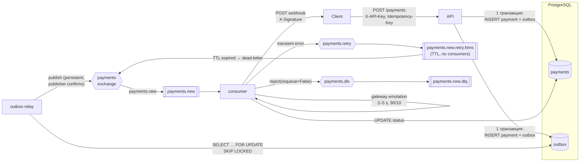

# Payments — асинхронный процессинг платежей

Микросервис принимает платёж и отвечает `202 Accepted`. Затем он асинхронно проводит платёж через эмулятор платёжного шлюза и сообщает клиенту результат вебхуком.

**Стек:** FastAPI · Pydantic v2 · SQLAlchemy 2.0 (async, asyncpg) · PostgreSQL 16 · RabbitMQ 3.13 (FastStream) · Alembic · Docker Compose · uv

**Что реализовано:**
- **Transactional Outbox.** Событие пишется в той же транзакции, что и платёж, а relay публикует его в RabbitMQ.
- **Идемпотентность API** по `Idempotency-Key` (без гонок, защищено уникальным индексом). Идемпотентна и обработка в consumer'е.
- **Retry** с экспоненциальной задержкой на TTL-очередях RabbitMQ и **DLQ** через нативный dead-lettering.
- **Подпись вебхуков** HMAC-SHA256 и стабильный `X-Webhook-Id` для дедупликации на стороне получателя.

---

## Быстрый старт

```bash
docker compose up --build
```

`.env` не обязателен: у всех параметров есть значения по умолчанию. Чтобы их поменять, выполните `cp .env.example .env`.

| Сервис         | Адрес                                       | Назначение                                   |
|----------------|---------------------------------------------|----------------------------------------------|
| `api`          | http://localhost:8000/docs                  | REST API (Swagger UI)                        |
| `rabbitmq`     | http://localhost:15672 (guest / guest)      | Management UI: очереди, DLQ                  |
| `webhook-mock` | http://localhost:9000/received              | демо-приёмник вебхуков                       |
| `outbox-relay` | —                                           | публикует события из таблицы `outbox`        |
| `consumer`     | —                                           | обрабатывает `payments.new`                  |
| `migrate`      | —                                           | `alembic upgrade head`, запускается один раз |

Сервисы `api`, `outbox-relay` и `consumer` стартуют только после того, как `postgres` и `rabbitmq` стали healthy, а миграции завершились успешно.

## Примеры

```bash
export API=http://localhost:8000/api/v1/payments KEY=dev-secret-api-key
```

**Создать платёж:**

```bash
curl -i -X POST $API \
  -H "X-API-Key: $KEY" -H "Idempotency-Key: order-42" -H "Content-Type: application/json" \
  -d '{"amount": "1500.00", "currency": "RUB", "description": "Order #42",
       "metadata": {"order_id": 42}, "webhook_url": "http://webhook-mock:9000/webhook"}'
```

```http
HTTP/1.1 202 Accepted

{"payment_id": "3f0c…", "status": "pending", "created_at": "2026-10-14T10:00:00Z"}
```

**Повтор запроса:**
- Тот же ключ и то же тело: снова `202` с тем же `payment_id` и заголовком `Idempotent-Replayed: true`. Новый платёж не создаётся.
- Тот же ключ, но другое тело (например, `"amount": "1.00"`): `409 Conflict`.

**Получить платёж** (через 2–5 с статус станет `succeeded` или `failed`):

```bash
curl -s $API/<payment_id> -H "X-API-Key: $KEY"
```

```json
{
  "payment_id": "3f0c…", "amount": "1500.00", "currency": "RUB", "description": "Order #42",
  "metadata": {"order_id": 42}, "status": "succeeded",
  "webhook_url": "http://webhook-mock:9000/webhook",
  "webhook_delivered_at": "2026-10-14T10:00:04Z",
  "created_at": "2026-10-14T10:00:00Z", "processed_at": "2026-10-14T10:00:04Z"
}
```

**Ошибки:**
- без `X-API-Key` или с неверным ключом: `401`;
- без `Idempotency-Key` или с невалидным телом: `422`;
- неизвестный `payment_id`: `404`.

### Как посмотреть retry и DLQ

```bash
# приёмник вебхуков начинает всегда отвечать 503
curl -X PUT localhost:9000/config -H "Content-Type: application/json" -d '{"fail_rate": 1.0}'
# создаём платёж (команда выше, но с новым Idempotency-Key) и смотрим логи
docker compose logs -f consumer
```

В логах будет три попытки с паузами около 2 с и 4 с. После этого сообщение окажется в очереди `payments.new.dlq` (вкладка Queues в UI RabbitMQ). Платёж при этом остаётся `succeeded` или `failed`: результат проведения не теряется. В нём будет `webhook_delivered_at = null`, а в БД — `webhook_attempts = 3` и `webhook_last_error`.

### Автоматический smoke-тест

```bash
make e2e   # или: uv run python scripts/e2e.py — при запущенном docker compose
```

Скрипт проверяет три сценария:
1. 10 платежей доходят до финального статуса, все вебхуки доставлены, подпись проверена.
2. Идемпотентность и `409`.
3. Три попытки и DLQ.

---

## Архитектура



### Жизненный цикл платежа

```mermaid
sequenceDiagram
    autonumber
    participant C as Client
    participant A as API
    participant DB as PostgreSQL
    participant R as outbox-relay
    participant MQ as RabbitMQ
    participant W as consumer
    C->>A: POST /payments (Idempotency-Key)
    A->>DB: BEGIN; INSERT payment ON CONFLICT DO NOTHING; INSERT outbox; COMMIT
    A-->>C: 202 {payment_id, pending}
    R->>DB: lock unpublished outbox rows (SKIP LOCKED)
    R->>MQ: publish payments.new (persistent, confirm)
    R->>DB: published_at = now(); COMMIT
    MQ->>W: deliver payments.new
    W->>DB: status pending? → gateway (2–5 s)
    W->>DB: UPDATE … SET status WHERE status = 'pending'
    W->>C: POST webhook_url
    alt 2xx
        W->>DB: webhook_delivered_at = now()
        W->>MQ: ack
    else 5xx / timeout, attempt < 3
        W->>MQ: publish copy → payments.retry (x-attempt+1), then ack
        MQ-->>MQ: TTL 2 s / 4 s → back to payments.new
    else attempts exhausted or 4xx
        W->>MQ: reject(requeue=False) → payments.dlx → payments.new.dlq
    end
```

### Структура кода

```
src/payments/
├── api/            FastAPI: app factory, роуты, зависимости (auth, сессия)
├── core/           настройки (pydantic-settings), логирование
├── db/             модели SQLAlchemy, engine/session factory
├── domain/         enum'ы и доменные исключения (Retryable / NonRetryable)
├── schemas/        Pydantic-схемы API и событий
├── repositories/   доступ к данным: payments, outbox
├── services/       бизнес-логика: создание платежа, обработка (state machine),
│                   эмулятор шлюза, отправка вебхуков, outbox relay
├── messaging/      топология RabbitMQ, брокер, publisher, обработчик ack/retry/DLQ
└── workers/        точки входа: consumer, outbox_relay
migrations/         Alembic (async), миграция написана вручную
tools/webhook_mock.py   демо-приёмник вебхуков
scripts/e2e.py          smoke-тест на поднятом стеке
```

Зависимости направлены так: `api/workers → services → repositories → db`. Шлюз, отправитель вебхуков, publisher и retrier скрыты за `Protocol`-интерфейсами. Поэтому бизнес-логика тестируется с фейками, без моков на уровне модулей.

---

## Гарантии доставки и ключевые решения

### 1. Transactional Outbox

Без outbox возможны две аварийные ситуации:
- платёж закоммичен, а публикация в брокер не прошла: событие потеряно;
- событие опубликовано, а транзакция откатилась: событие-фантом.

Поэтому API **никогда не ходит в брокер**: строка `outbox` пишется в той же транзакции, что и `payments`.

`outbox-relay` (отдельный процесс) в цикле выполняет:
1. `SELECT … WHERE published_at IS NULL ORDER BY created_at LIMIT N FOR UPDATE SKIP LOCKED`. `SKIP LOCKED` позволяет запустить несколько реплик relay: каждая возьмёт свои строки, никто не заблокируется и не опубликует одно и то же дважды (это покрыто тестом).
2. Публикацию с `persist=True` (delivery mode 2), `mandatory=True`, publisher confirms и `on_return_raises`. `publish()` возвращается только тогда, когда RabbitMQ подтвердил приём. Если сообщение некуда маршрутизировать, будет ошибка, а не тихий drop.
3. `published_at = now()` и COMMIT. При ошибке увеличивается `attempts`, пишется `last_error`, строка остаётся на следующий проход.

**Итоговая гарантия — at-least-once.** Если relay упадёт между confirm и COMMIT, событие уйдёт повторно. Это ожидаемо, такой дубль поглощает идемпотентный consumer (раздел 3).

По индексам:
- для выборки используется частичный индекс `ix_outbox_unpublished (created_at) WHERE published_at IS NULL`. Он содержит только неопубликованные строки и не растёт вместе с историей;
- `message_id` = `outbox.id`, `correlation_id` = `payment_id`.

### 2. Идемпотентность API

- `idempotency_key` — `UNIQUE`. Создание выполняется одним `INSERT … ON CONFLICT (idempotency_key) DO NOTHING RETURNING *`. Гонку двух одновременных запросов с одним ключом разрешает PostgreSQL: второй `INSERT` ждёт коммита первого на уникальном индексе. Схемы «сначала SELECT, потом INSERT» здесь нет (тест: 10 параллельных запросов дают 1 платёж и 1 событие).
- В `request_hash` хранится sha256 канонизированного тела. Ключи JSON сортируются, сумма нормализуется, так что `100`, `100.0` и `100.00` дают один и тот же хеш.
  - Повтор с тем же телом возвращает тот же ответ (`202`, тот же `payment_id`, заголовок `Idempotent-Replayed: true`).
  - Повтор с другим телом возвращает `409 Conflict`: это почти наверняка ошибка клиента, молча вернуть «чужой» платёж было бы хуже.

### 3. Идемпотентность consumer'а: at-least-once → effectively-once

Прогресс хранится **в строке платежа, а не в сообщении**, поэтому повторная доставка продолжает с места остановки:

```
pending ──gateway──► succeeded/failed ──webhook──► webhook_delivered_at
```

- Шлюз вызывается, только если `status = pending`.
- Результат фиксируется условным `UPDATE … WHERE status = 'pending'`: переход происходит ровно один раз. Если параллельная доставка дубля успела раньше, побеждает её результат.
- Вебхук отправляется, только если `webhook_delivered_at IS NULL`. Retry после ошибки вебхука **не проводит платёж повторно** (тест `test_webhook_retry_does_not_charge_again`).
- Во время ожидания шлюза (2–5 с) или вебхука не держится ни транзакция, ни блокировка строки: каждый шаг — своя короткая транзакция.
- Узкое место, о котором стоит сказать честно: две *одновременные* доставки дубля обе позовут шлюз. В реальной интеграции `payment.id` передаётся шлюзу как его idempotency key, так что второго списания не будет. Вебхук в этом случае может прийти дважды, поэтому у него стабильный `X-Webhook-Id = "<payment_id>:<status>"` для дедупликации на стороне получателя. Это стандартный контракт вебхуков (Stripe, ЮKassa).

### 4. Что ретраим, а что нет

| Ситуация                                           | Действие                                           |
|----------------------------------------------------|----------------------------------------------------|
| Шлюз отклонил платёж (эмуляция, 10%)               | бизнес-результат `failed`, вебхук с `failed`, **без retry** |
| Вебхук: timeout, connection error, 5xx, 408/425/429 | retry с экспоненциальной задержкой                 |
| Вебхук: прочие 4xx, 3xx                            | сразу в DLQ: повтор не поможет                     |
| БД или иное непредвиденное исключение              | retry (ограниченное число раз)                     |
| Невалидное сообщение или неизвестный `payment_id`  | сразу в DLQ (poison message)                       |

### 5. Retry и DLQ средствами RabbitMQ

**Топология** (объявляется идемпотентно при старте и relay, и consumer'ом):

| Exchange (direct) | Queue                       | Аргументы                                                     |
|-------------------|-----------------------------|----------------------------------------------------------------|
| `payments`        | `payments.new`              | `x-dead-letter-exchange=payments.dlx`, `x-dead-letter-routing-key=payments.new.dlq` |
| `payments.retry`  | `payments.new.retry.2000ms` | `x-message-ttl=2000`, DLX → `payments` / `payments.new`        |
| `payments.retry`  | `payments.new.retry.4000ms` | `x-message-ttl=4000`, DLX → `payments` / `payments.new`        |
| `payments.dlx`    | `payments.new.dlq`          | —                                                              |

**Алгоритм** (consumer работает в `AckPolicy.MANUAL`):
1. Успех: `ack`.
2. Временная ошибка и `x-attempt < MAX_ATTEMPTS`: копия сообщения публикуется (с confirm) в retry-очередь с нужной задержкой и `x-attempt + 1`, **после этого** оригинал получает `ack`. Если упасть между этими шагами, получится дубль, а не потеря.
3. У retry-очередей нет consumer'ов. Сообщение лежит до истечения TTL, после чего RabbitMQ сам возвращает его в `payments.new` через dead-lettering.
4. Попытки исчерпаны или ошибка постоянная: `reject(requeue=False)`. Дальше работает **нативный** DLX самой очереди `payments.new`, сообщение попадает в `payments.new.dlq` с заголовком `x-death`.

**Почему так, а не иначе:**
- `asyncio.sleep()` внутри обработчика держит слот prefetch, пока ждёт, а при рестарте задержка теряется. С `nack(requeue=True)` получится горячий цикл без задержки.
- Плагин `rabbitmq_delayed_message_exchange` — лишняя зависимость в инфраструктуре и не реплицируется.
- Задержка зашита в имя retry-очереди. Поэтому смена `RETRY_BASE_DELAY` создаёт новые очереди вместо `PRECONDITION_FAILED` при повторном объявлении с другими аргументами.
- `MAX_ATTEMPTS=3` означает три попытки всего (первая + 2 повтора), задержки 2 с и 4 с (`RETRY_BASE_DELAY · RETRY_MULTIPLIER^n`). Если ТЗ подразумевает три *повтора*, достаточно выставить `MAX_ATTEMPTS=4`.

### 6. Прочее

- **Деньги.** `NUMERIC(18,2)` в БД и `Decimal` в коде. В JSON сумма отдаётся **строкой** (`"1500.00"`), чтобы не было потерь точности на float у клиента.
- **Валюта и статус** — `VARCHAR` + `CHECK` вместо native enum: добавить значение можно заменой constraint, без `ALTER TYPE`.
- **Аутентификация** — `X-API-Key` на всех эндпоинтах `/api/v1/*`, сравнение через `secrets.compare_digest` (без timing-атак). Healthcheck'и `/health/live` и `/health/ready` открыты.
- **Вебхуки.** Подпись `X-Signature: sha256=HMAC(secret, body)`. Демо-приёмник её проверяет (`signature_ok` в `/received`). Редиректы не следуются.
- **Graceful shutdown.** FastStream дожидается обработки текущего сообщения (`stop_grace_period: 20s` в compose), relay доделывает текущую пачку.
- **Docker.** Multi-stage сборка на `uv`: слой зависимостей кэшируется, в runtime-образе нет компиляторов и dev-зависимостей, процесс запускается от non-root пользователя. Один образ используется для всех сервисов.

---

## Соответствие требованиям ТЗ

| Требование                         | Где                                                                                     |
|------------------------------------|-----------------------------------------------------------------------------------------|
| 1. Модели и миграции               | `src/payments/db/models.py`, `migrations/versions/0001_init.py`                         |
| 2. API эндпоинты                   | `src/payments/api/routes/payments.py`, `src/payments/services/payments.py`              |
| 3. Consumer                        | `src/payments/workers/consumer.py`, `src/payments/services/processing.py`               |
| 4. Outbox pattern                  | `src/payments/services/outbox_relay.py`, `src/payments/repositories/outbox.py`          |
| 5. Retry (3 попытки, экспонента)   | `src/payments/messaging/handler.py`, `src/payments/messaging/topology.py`               |
| 6. Dead Letter Queue               | `src/payments/messaging/topology.py` (DLX на `payments.new`)                            |
| 7. Docker                          | `Dockerfile`, `docker-compose.yml`                                                      |
| 8. Документация                    | этот README                                                                              |
| Idempotency key                    | `src/payments/repositories/payments.py` (`insert_if_absent`), `schemas/payment.py` (`fingerprint`) |
| Аутентификация `X-API-Key`         | `src/payments/api/deps.py`                                                              |

---

## Разработка

```bash
uv sync                 # зависимости, включая dev
make lint typecheck     # ruff + mypy --strict
make test               # unit + integration (Postgres поднимается через testcontainers, нужен Docker)
make test-unit          # только unit, без Docker
```

Локальный запуск без контейнеров для приложения:

```bash
docker compose up -d postgres rabbitmq
uv run alembic upgrade head
uv run uvicorn payments.api.app:create_app --factory --reload
uv run python -m payments.workers.outbox_relay
uv run python -m payments.workers.consumer
```

**Тесты:**
- **unit** — валидация и fingerprint, классификация ответов вебхука, подпись, эмулятор шлюза, логика ack/retry/DLQ обработчика;
- **integration** (реальный PostgreSQL) — API (202 / 404 / 401 / 409 / 422, конкурентные запросы с одним ключом), outbox relay (публикация, сбой брокера, параллельные реплики), state machine обработки (повторная доставка, retry вебхука без повторного списания, конкурентная финализация);
- **e2e** — `scripts/e2e.py` на поднятом стеке, в том числе реальные retry и DLQ в RabbitMQ.

## Конфигурация

| Переменная               | По умолчанию | Описание                                          |
|--------------------------|--------------|---------------------------------------------------|
| `API_KEY`                | —            | статический ключ для `X-API-Key`                  |
| `DATABASE_URL`           | localhost    | `postgresql+asyncpg://…`                          |
| `RABBIT_URL`             | localhost    | `amqp://…`                                        |
| `MAX_ATTEMPTS`           | `3`          | попыток всего, включая первую                     |
| `RETRY_BASE_DELAY`       | `2`          | задержка перед первым повтором, с                 |
| `RETRY_MULTIPLIER`       | `2`          | множитель экспоненты                              |
| `CONSUMER_PREFETCH`      | `10`         | prefetch_count consumer'а                         |
| `OUTBOX_POLL_INTERVAL`   | `0.5`        | период опроса outbox, с                           |
| `OUTBOX_BATCH_SIZE`      | `100`        | размер пачки relay                                |
| `GATEWAY_SUCCESS_RATE`   | `0.9`        | доля успешных платежей в эмуляторе                |
| `GATEWAY_MIN/MAX_DELAY`  | `2` / `5`    | задержка эмулятора, с                             |
| `WEBHOOK_TIMEOUT`        | `5`          | таймаут HTTP-запроса вебхука, с                   |
| `WEBHOOK_SECRET`         | —            | секрет HMAC-подписи вебхуков                      |

---

## Что сделал бы дальше для продакшена

- **Outbox.**
  - Debezium CDC (WAL → брокер) вместо polling, либо `LISTEN/NOTIFY` для снижения задержки.
  - Регулярная очистка или партиционирование по времени опубликованных строк `outbox`.
- **RabbitMQ.**
  - Quorum queues (репликация) с `x-dead-letter-strategy=at-least-once`.
  - Инструмент redrive из DLQ (`payments.new.dlq` → `payments.new`) после исправления причины.
- **Наблюдаемость.**
  - Prometheus-метрики: лаг outbox (возраст самой старой неопубликованной строки), глубина DLQ, доля retry.
  - Трейсинг OpenTelemetry (у FastStream и FastAPI есть готовые middleware).
  - Структурированные JSON-логи с `payment_id` / `correlation_id`.
- **Безопасность.**
  - Защита от SSRF при отправке вебхуков: запрет приватных подсетей и резолв DNS с проверкой.
  - Отдельные API-ключи на клиента и их ротация. Тогда idempotency key уникален в паре `(client_id, key)`, а не глобально.
  - TTL на idempotency-ключи.
- **Шлюз.** Circuit breaker на вызовы внешнего шлюза и `payment.id` как idempotency key провайдера.
- **Статус `processing`.** Позволит отличать «в обработке» от «ещё не взят» и блокировать дубль до похода в шлюз (lease с `locked_until`).
